# Solace AI — Platform Architecture

## 1. System Overview

Solace AI is evolving from a single conversational companion into an extensible, modular emotional wellness platform. The platform connects a cross-platform mobile client (React Native / Expo) to a high-performance Python backend (FastAPI), backed by Supabase PostgreSQL for persistence and Google Gemini for generative and multimodal intelligence.

```mermaid
flowchart TD
    subgraph MobileApp ["Mobile Application Layer (React Native / Expo)"]
        UI_Screens["UI Screens\n(Companion, Words of Solace, Voice Journal, Landscape, Discover)"]
        UI_Stores["Zustand State Stores\n(Auth, Chat, Memory, Journal, Poetry, Landscape)"]
        UI_Services["Client API Services\n(api.ts, voice.ts, sseClient.ts)"]
    end

    subgraph FastAPILayer ["FastAPI Application Layer (API Gateway & Ingress)"]
        CORS_Auth["Auth Middleware & Bearer JWT Validation (Supabase Auth)"]
        Routers["HTTP & SSE Endpoints\n(/chat/stream, /poetry, /journals, /landscape, /wellbeing, /voice)"]
        Contracts["Pydantic Ingress Contracts & Deterministic Validation"]
    end

    subgraph OrchestrationLayer ["Orchestration Layer (LangGraph & Router Engine)"]
        Safety_Screen["Deterministic Safety Interception\n(Crisis Regex / India 14416 & 112)"]
        Mode_Router["Intent & Workflow Router\n(Feature Flag: ENABLE_LANGGRAPH_ROUTING)"]
        State_Context["Typed State Machine & Context Assembler\n(CompanionState / WorkflowState)"]
    end

    subgraph FeatureServices ["Independent Feature Services"]
        Companion_Svc["Companion Service\n(Rant Mode & Post-Rant)"]
        Poetry_Svc["Words of Solace Service\n(Multilingual Poetry Gen)"]
        Journal_Svc["Voice Journal Service\n(Transcription & Reflection)"]
        Landscape_Svc["Emotional Landscape Service\n(Sanctuary & Grounding Visuals)"]
        Wellbeing_Svc["Holistic Wellbeing Service\n(Everyday Suggestions & Dismissals)"]
    end

    subgraph PersistenceProviders ["Persistence & External Providers"]
        Supabase_DB[("Supabase PostgreSQL\n(Profiles, Check-Ins, Messages, Memories,\nPoetry, Journals, Suggestions)")]
        Supabase_RLS["Row Level Security (RLS)\nauth.uid() = user_id"]
        Gemini_API["Google Gemini API (3.5-flash-lite)\n(Streaming Text, Audio Transcription, Multilingual)"]
    end

    MobileApp --> FastAPILayer
    FastAPILayer --> OrchestrationLayer
    OrchestrationLayer --> FeatureServices
    FeatureServices --> PersistenceProviders
```



---

## 2. Layered Architecture Specifications

### 2.1 Mobile Application Layer
- **Framework**: React Native 0.76.7 / Expo SDK 52.
- **Routing**: Expo Router (file-based navigation with `(tabs)` and modal flows).
- **State Management**: Zustand stores with discrete domain responsibilities:
  - `useAuthStore`: Session management, guest mode switching, profile sync.
  - `useChatStore`: Companion SSE streaming, message state, Rant Mode toggles.
  - `useMemoryStore`: Consent-based emotional memory inspection, approval, deletion.
  - `usePoetryStore`: Multilingual poem generation, theme selection, local/remote bookmarking.
  - `useJournalStore`: Audio recording lifecycle, transcription preview, private entry storage.
  - `useLandscapeStore`: Interactive mood ambiance, particle/fluid parameters, grounding sync.
- **Data Fetching & Cache**: TanStack Query (React Query) for asynchronous remote collections with optimistic local updates.
- **Hardware & Device Capabilities**:
  - `expo-av`: Push-to-talk microphone capture, audio playback preview, and temporary file lifecycle.
  - `expo-speech`: Offline native device text-to-speech (TTS) for voice replies.
  - `react-native-reanimated`: 60fps hardware-accelerated ambient visuals and breathing sphere animations.
  - `expo-haptics`: Tactile feedback for breathing rhythms and mood selections.

### 2.2 FastAPI Application Layer
- **Framework**: FastAPI with ASGI server (Uvicorn).
- **Authentication**: Bearer token extraction validated against Supabase Auth public key/JWT verifier; guest-mode requests isolated to non-persisted routes.
- **Ingress Validation**: Strict Pydantic v2 schemas validating payload structure, MIME types, character boundaries, and UTF-8 encoding.
- **Streaming Ingress/Egress**: Standard Server-Sent Events (SSE) using `StreamingResponse(media_type="text/event-stream")` with chunk headers:
  - `Cache-Control: no-cache`
  - `Connection: keep-alive`
  - `X-Accel-Buffering: no`

### 2.3 Orchestration Layer (LangGraph Engine)
- **Role**: Coordinates multi-step, governed agentic workflows while strictly honoring deterministic boundaries.
- **Governing Invariants**:
  1. **Deterministic Safety Priority**: Safety interception occurs before invoking any graph node or model call.
  2. **Streaming Transparency**: The orchestration layer yields token chunks directly as an async generator, preventing full-response buffering.
  3. **Feature-Flagged Routing**: Controlled by `ENABLE_LANGGRAPH_ROUTING=true/false` with an instantaneous fallback to the tested native pipeline.
  4. **Privacy-Preserving Execution**: State checkpointers do not write raw conversation confessions, audio buffers, or journals to external trace servers (no external LangSmith telemetry).

### 2.4 Independent Feature Services
Each feature service is encapsulated within `backend/app/services/<feature>_service.py` with its own typed contract:
1. **Companion Service**: Manages standard reflection, Rant Mode ("Just Let It Out"), and post-rant preference transitions.
2. **Words of Solace Service**: Generates culturally authentic, emotionally attuned poetry in English, Urdu (Nastaliq script), Roman Urdu, and bilingual formats.
3. **Voice Journal Service**: Transcribes ephemeral audio, generates optional grounded reflections, and persists user-encrypted private journals without saving raw audio.
4. **Emotional Landscape Service**: Translates categorical user moods into procedural ambient parameters (palette, particle density, ambient speed, soundscapes).
5. **Holistic Wellbeing Service**: Computes deterministic, non-prescriptive, daily wellbeing nudges (stretching, hydration, breath breaks) with strict negative constraint enforcement.

### 2.5 Persistence & Provider Layer
- **Database**: Supabase PostgreSQL with strict Row Level Security (RLS) on all user-owned tables.
- **AI Engine**: Google Gemini API via official `google-genai` SDK using `gemini-3.5-flash-lite` for text and multimodal audio processing.
- **Data Isolation**: Guest users maintain zero server-side state; all guest interactions exist purely in mobile memory and AsyncStorage.

---

## 3. Communication Patterns & Lifecycles

### 3.1 Streaming SSE Lifecycle (Companion & Reflection)
```
[Mobile] --- POST /chat/stream ---> [FastAPI Router]
                                           |
                              [Deterministic Safety Check]
                               (Matches Crisis? -> Yields 14416 & Exit)
                                           |
                              [Context Assembly: Mem + CheckIn]
                                           |
                            [Gemini 3.5 Flash Lite Stream]
                                           |
   [Mobile UI] <--- SSE token chunks <----+ (Full-duplex Async Generator)
        |
   [Mobile UI] <--- SSE message_complete <--- [Background DB Persistence]
```

### 3.2 Ephemeral Voice Journal Lifecycle
```
[User Speaks] ---> [expo-av temp file (.m4a)]
                         |
               [Base64 in Memory]
                         |
[Mobile] --- POST /voice/transcribe ---> [FastAPI /voice/transcribe]
                                                  |
                                      [Gemini Multimodal Speech-to-Text]
                                                  |
                                      [Zero-Disk Audio Buffer Delete]
                                                  |
[Mobile UI] <--- JSON { text } <------------------+
     |
[User Reviews/Edits Transcript]
     |
[User Taps Save] ---> POST /journals ---> [Supabase public.voice_journals (RLS)]
```

