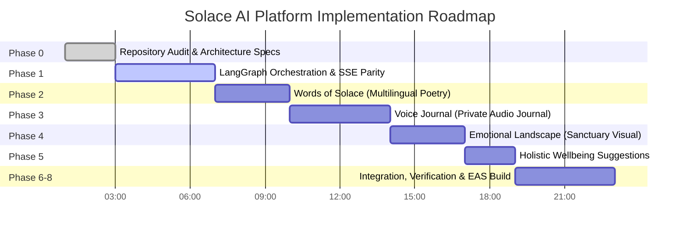

# Solace AI — Platform Implementation Roadmap & Migration Strategy

## 1. Overview & Timeline

- **Target Deadline**: November 10, 2026, 11:59 AM IST.
- **Objective**: Execute a phased, non-breaking evolution of Solace AI across 5 core capabilities while preserving the audited 4.97/5.00 conversational baseline.

---

## 2. Phase-by-Phase Execution Plan

### Phase 0: Repository Audit & Architecture Design (COMPLETED)
- **Deliverables**:
  - `docs/ARCHITECTURE.md`
  - `docs/ARCHITECTURE_DECISIONS.md`
  - `docs/FEATURE_CONTRACTS.md`
  - `docs/IMPLEMENTATION_ROADMAP.md`
- **Verification**: Review architecture boundaries, Pydantic contracts, and migration SQL.

---

### Phase 1: LangGraph Orchestration Foundation (COMPLETED)
- **Goal**: Implement LangGraph workflow routing behind `ENABLE_LANGGRAPH_ROUTING=false` (default) with zero disruption to streaming.
- **Backend Tasks**:
  - Created `backend/app/orchestration/` (`state.py`, `nodes/`, `routing.py`, `graph.py`).
  - Wired `/chat/stream` with safe native fallback and `astream_events(v2)` custom event token streaming.
  - Benchmarked TTFT and latency parity against native generator.
- **Status**: 14/14 tests passing. Report: `docs/LANGGRAPH_IMPLEMENTATION_REPORT.md`.

---

### Phase 2: Words of Solace (Multilingual Poetry) (COMPLETED)
- **Goal**: Dedicated poetry generation service with English, Urdu script (Nastaliq), Roman Urdu, and bilingual formats.
- **Backend Tasks**:
  - Implemented `backend/app/schemas/poetry.py`.
  - Implemented `backend/app/services/poetry_service.py` with structured Gemini prompts for Nastaliq, Urdu phonetic consistency, and gentle reflections.
  - Implemented `backend/app/repositories/poetry_repository.py`.
  - Added API endpoints in `backend/app/api/poetry.py` (`POST /poetry/generate`, `POST /poetry/save`, `GET /poetry/saved`, `DELETE /poetry/saved/{id}`).
  - Added migration `database/migrations/00004_words_of_solace.sql` with strict RLS.
- **Mobile Tasks**:
  - Created `mobile/types/poetry.ts`.
  - Added poetry methods to `mobile/services/api.ts`.
  - Created `mobile/store/usePoetryStore.ts` with local guest mode storage partitioning.
  - Created `mobile/components/PoetryModal.tsx` with RTL Nastaliq typography, bilingual layout, and copy/save actions.
  - Added Words of Solace sanctuary card in `mobile/app/(tabs)/discover.tsx`.
- **Status**: 7/7 backend tests passing, 3/3 mobile test suites passing, Metro Android bundle verified.

---

### Phase 3: Voice Journal (Private Audio Journaling) [COMPLETED]
- **Goal**: Private audio recording, preview, transcription, mandatory editing, and grounded reflection.
- **Backend Tasks**:
  - Implemented `backend/app/schemas/journal.py`.
  - Implemented `backend/app/repositories/journal_repository.py` (Supabase + local fallback, strict user isolation).
  - Implemented `backend/app/services/journal_service.py` (grounded reflection + deterministic crisis screening).
  - Registered `backend/app/api/journal.py` (`POST /journal/save`, `GET/PATCH/DELETE /journal/entries`, `POST /journal/reflect`).
  - Enforced zero raw audio retention; in-memory audio buffers deleted immediately.
  - Verified 5/5 backend test suites in `backend/tests/test_journal.py`.
- **Mobile Tasks**:
  - Created `mobile/types/journal.ts` and `mobile/services/journal.ts`.
  - Implemented `mobile/store/useJournalStore.ts` with indexed per-entry chunking avoiding Android SecureStore 2KB limits.
  - Built `mobile/components/VoiceJournalModal.tsx` with recording controls, timer, mandatory transcript review, mood tags, optional AI reflection, and full collection management.
  - Integrated Voice Journal entry point into `mobile/app/(tabs)/discover.tsx`.
  - Verified 8/8 mobile test suites in `mobile/tests/journal.test.js`.
- **Gate**: Audio permission denial handled gracefully; zero raw audio stored; transcripts strictly user-reviewed before saving; guest entries persisted locally across restarts without writing unauthenticated rows to Supabase; regression suites green.

---

### Phase 4: Emotional Landscape (Visual Mood Sanctuary)
- **Goal**: Responsive, calm visual sanctuary utilizing React Native Reanimated.
- **Mobile Tasks**:
  - Create `mobile/store/useLandscapeStore.ts`.
  - Build `mobile/components/EmotionalLandscape.tsx` and integrate it into `mobile/app/(tabs)/index.tsx` or a dedicated sanctuary modal.
  - Implement mood-reactive color gradients, gentle particle motion, and reduced-motion toggle.
  - Connect seamless transition to the existing Box Breathing Visualizer.
- **Gate**: Smooth 60fps on Android emulator; zero memory/worklet leaks on screen unmount; accessible contrast.

---

### Phase 5: Holistic Wellbeing (Everyday Suggestions)
- **Goal**: Non-prescriptive, daily wellbeing invitations with explicit dismissals.
- **Backend Tasks**:
  - Implement `backend/app/schemas/wellbeing.py`.
  - Implement `backend/app/services/wellbeing_service.py` with deterministic guardrails (no diet/medical prescriptions).
  - Add `backend/app/api/wellbeing.py` (`GET /wellbeing/suggestions`, `POST /wellbeing/dismiss`).
- **Mobile Tasks**:
  - Build `mobile/components/WellbeingCard.tsx` in `mobile/app/(tabs)/index.tsx`.
  - Support instant dismissal and action triggers (e.g., launch breathing, open journal).
- **Gate**: Dismissal recorded; no medical claims; suggestions never silently become emotional memories.

---

### Phase 6: Integration & Coherence
- **Goal**: Unified navigation, shared theme tokens, and guest-mode consistency.
- **Tasks**:
  - Verify tab bar and modal routes in `mobile/app/(tabs)/_layout.tsx`.
  - Ensure consistent color palettes (Sage `#4E7A58`, Warm Ivory `#FAF8F5`, Sand `#F2EDE4`).
  - Verify back navigation, Android hardware back buttons, and accessibility labels.

---

### Phase 7: Security, Privacy & Acceptance Testing
- **Deliverables**:
  - `docs/QUALITY_AND_PRIVACY.md`
  - `docs/FINAL_ACCEPTANCE_REPORT.md`
- **Tasks**:
  - Execute backend unit and integration test suite (`pytest`).
  - Execute mobile TypeScript checks (`npx tsc --noEmit`).
  - Verify RLS isolation between distinct test accounts.
  - Verify zero secrets in client bundle or Git history.

---

### Phase 8: Final Build & Demonstration
- **Tasks**:
  - Apply `00004_platform_expansion.sql` to Supabase.
  - Deploy updated backend to Render.
  - Build EAS Android preview APK (`eas build --platform android --profile preview`).
  - Run end-to-end user journeys on Pixel 7 emulator (`emulator-5554`).
  - Capture showcase screenshots and prepare demonstration guide.

---

## 3. Risk Mitigation & Fallback Matrix

| Potential Risk | Severity | Mitigation Strategy |
| :--- | :---: | :--- |
| **LangGraph Streaming Latency Surge** | High | Keep `ENABLE_LANGGRAPH_ROUTING=false` during production baseline; route through tested native generator if TTFT exceeds 2.0s. |
| **Urdu Font Rendering on Android** | Medium | Use standard Android system Arabic/Persian/Urdu fallbacks with proper `writingDirection: 'rtl'` and line-height padding. |
| **Microphone Permission Denials** | Medium | Provide instant text fallback for Voice Journal; never lock the user out of journaling if audio permissions are denied. |
| **Render Cold Starts on Free Tier** | Low | Ping `GET /health` 2 minutes prior to live demonstration. |
| **Database Schema Conflicts** | High | All new tables use distinct names (`words_of_solace`, `voice_journals`, `wellbeing_dismissals`) with independent foreign keys to `auth.users(id)`. |

