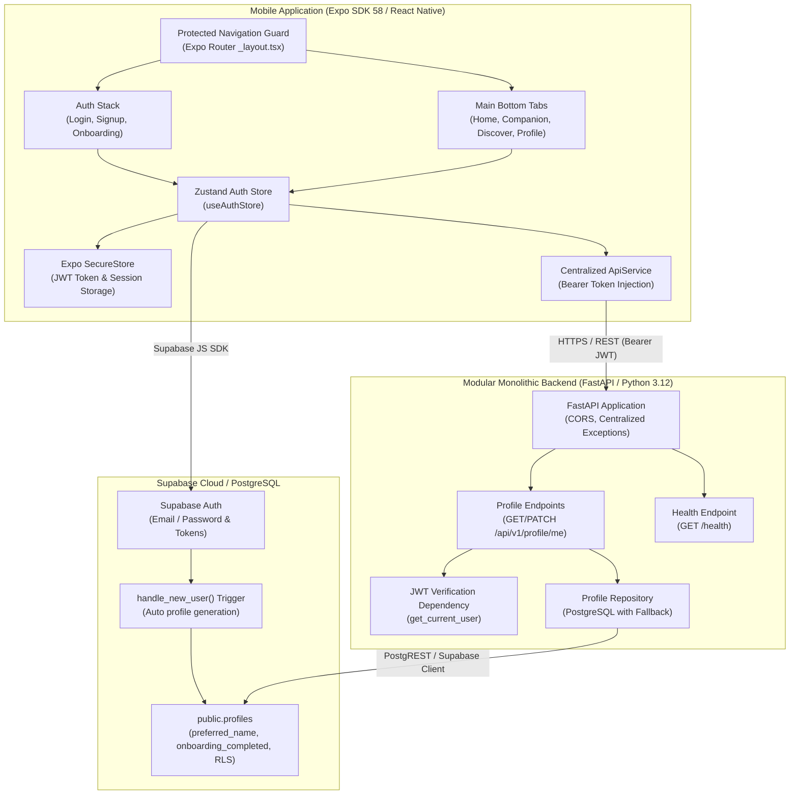

# Solace AI — Project Architecture & Technology Decisions

> **Tagline:** *A little space to feel understood.*  
> **Product:** Solace AI — Premium AI-Powered Wellness Companion

---

## 1. High-Level Architecture Overview

Solace AI is designed as a **modern client-server wellness platform** comprising a React Native Expo mobile application, a modular monolithic FastAPI backend, a Supabase PostgreSQL database with Row-Level Security (RLS), and an AI inference layer powered exclusively through backend abstractions (Google Gemini API).

---

## 2. Authentication & Session Architecture

### 2.1 Mobile Client Auth Flow
1. **Supabase Client with Custom Storage**: Initialized with `ExpoSecureStoreAdapter` which persists sessions using `expo-secure-store` on iOS and Android, and `window.localStorage` on Web.
2. **Session Restoration**: When the app boots, `useAuthStore.initialize()` queries `supabase.auth.getSession()` and checks for active guest tokens.
3. **Protected Route Guard**: `mobile/app/_layout.tsx` observes authentication state:
   - **Unauthenticated**: Redirected to `/(auth)/login`.
   - **Authenticated (Incomplete Onboarding)**: Redirected to `/onboarding`.
   - **Authenticated (Complete Onboarding) or Guest**: Routed to `/(tabs)`.
4. **Guest Mode**: Allows users to explore Solace without immediate signup. Guest flag is stored securely, but guest data is never synced to the cloud database.

### 2.2 Backend JWT Verification Flow
1. Mobile requests to `/api/v1/profile/*` supply `Authorization: Bearer <access_token>`.
2. The FastAPI `get_current_user` dependency:
   - Validates the token against `SUPABASE_JWT_SECRET` (if provided) or queries Supabase Auth via `supabase.auth.get_user(token)`.
   - Derives the user ID (`sub`) exclusively from verified claims. Client-supplied IDs are never trusted.
   - Raises `401 Unauthorized` for expired, malformed, or missing tokens.

---

## 3. Database Schema & RLS

### `public.profiles`
| Column | Type | Constraints / Default | Description |
| :--- | :--- | :--- | :--- |
| `id` | UUID | PRIMARY KEY, REFERENCES `auth.users(id)` | Identifies user strictly matching Supabase Auth |
| `email` | TEXT | NULLABLE | Account email |
| `display_name` | TEXT | NULLABLE | Full name |
| `preferred_name`| TEXT | NULLABLE | Preferred greeting name (e.g. "Aadil") |
| `avatar_url` | TEXT | NULLABLE | Profile photo URL |
| `onboarding_completed` | BOOLEAN | NOT NULL DEFAULT `false` | Gate for onboarding flow |
| `wellness_goals` | JSONB | DEFAULT `'[]'::jsonb` | Array of selected goals |
| `interaction_style` | TEXT | NULLABLE | Preferred AI companion tone (`gentle`, `grounded`, `practical`) |
| `created_at` | TIMESTAMPTZ | DEFAULT `now()` | Account creation timestamp |
| `updated_at` | TIMESTAMPTZ | DEFAULT `now()` | Last modification timestamp |

### Row Level Security (RLS) Policies
- **Select**: `CREATE POLICY "Users can view own profile" ON public.profiles FOR SELECT USING (auth.uid() = id);`
- **Update**: `CREATE POLICY "Users can update own profile" ON public.profiles FOR UPDATE USING (auth.uid() = id);`

---

## 4. UI & Navigation Architecture

### Bottom Tabs (`mobile/app/(tabs)`)
- **Home (`index.tsx`)**:
  - Time-of-day personalized greeting ("Good afternoon, Aadil.")
  - Mood check-in (Peaceful, Grateful, Reflective, Anxious, Heavy, Hopeful)
  - AI companion banner with quick entry
  - Daily reflection quote
  - Mindful practice shortcuts (Breathing, Journaling, Grounding)
  - Real user reflection progress
- **Companion (`companion.tsx`)**: Mindful dialogue entry and conversational reflection thread.
- **Discover (`discover.tsx`)**: Categorized wellness practices with guided modal instructions.
- **Profile (`profile.tsx`)**: Account credentials, guest status pill, preferred greeting editor, wellness preferences, and backend health diagnostic tool.

---

## 7. Phase 3: Emotional Intelligence, AI Companion & Consent-Based Memory

### Emotional Memory Architecture & Consent Model
Solace AI differentiates itself from standard chatbots by incorporating **Consent-Based Emotional Memory**:
1. **Detection**: During conversations, personal disclosures (ongoing challenges, coping mechanisms, goals, relationships, preferences) are detected heuristically or suggested by the AI companion.
2. **Consent Event**: The backend emits an SSE `memory_suggestion` event to the mobile client.
3. **User Action**: The client presents a serene consent banner directly above the chat composer (`"Would you like Solace to remember this?"`).
4. **Persistence**:
   - If the user approves, a `POST /api/v1/memories` request persists the insight under `user_memories`.
   - If the user declines, the pending memory is discarded immediately and never saved.
   - Users can review, toggle active/inactive, or delete any memory at any time in their Profile screen.

### AI Provider Architecture & Streaming Pipeline
- **Google Gemini API**: Integrated via `google-genai` SDK v3.0.0 (`gemini-2.5-flash` default).
- **Asynchronous Execution**: Model generation is executed in an async threadpool executor (`loop.run_in_executor`) to prevent blocking FastAPI's ASGI event loop.
- **Provider Interface**: Pluggable `AIProviderInterface` with `generate_response()` and `generate_response_stream()` supporting test swaps via `MockAIProvider`.
- **System Prompt Formulation**: Context incorporates:
  - User's preferred name and communication style (`gentle`, `grounded`, `practical`)
  - User's selected wellness goals
  - Active approved emotional memories matching context keywords
  - Recent mood check-in state
  - Sliding window of recent message history
- **Safety Interceptor**: Incoming user input is evaluated against crisis patterns prior to any AI model invocation. If detected, an immediate empathetic safety response with the 988 Suicide & Crisis Lifeline is returned with zero delay.

### Database Entities (Phase 3)
- `check_ins`: Daily mood check-in records with controlled moods (`peaceful`, `grateful`, `reflective`, `anxious`, `heavy`, `hopeful`), 1-5 intensity, and notes.
- `conversation_sessions`: Independent chat session containers.
- `conversation_messages`: Chronological conversation turns persisted per message.
- `user_memories`: Explicitly approved memory entries partitioned by user with active flag and categories.
